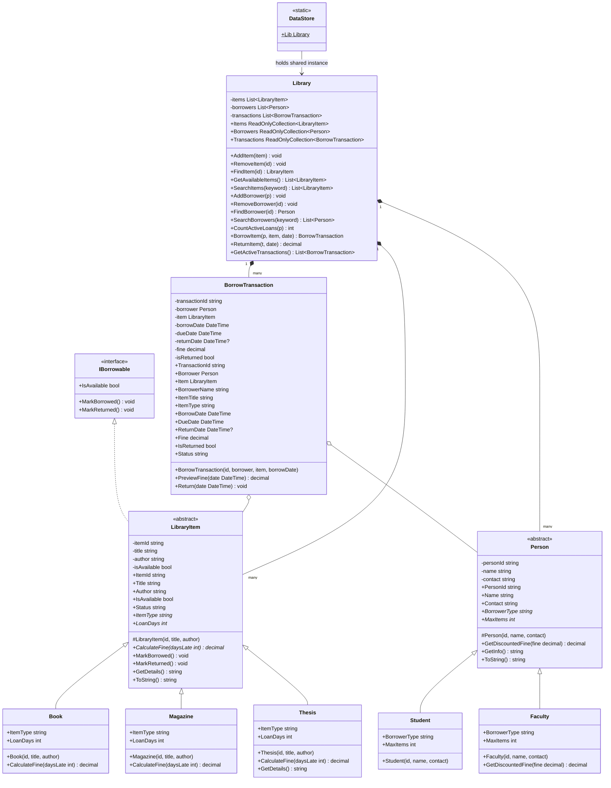

# Library Borrowing Management System - Project Documentation

## 1. Project Overview
The **Library Borrowing Management System** is a Windows desktop application developed in C# using Windows Forms. It manages library items (books, magazines, and theses), borrower registration (students and faculty), borrowing and return transactions, automatic computation of due dates and fines, and real-time item availability. The system addresses the problem of manual record-keeping in libraries, which often leads to lost records, unclear item availability, and incorrect fine computation. The system is built using the four pillars of Object-Oriented Programming.

## 2. Project Objectives
**General Objective**
To develop a Library Borrowing Management System that applies the four pillars of OOP to automate borrowing and return transactions.

**Specific Objectives**
1. To register and manage library items and borrowers.
2. To record borrowing transactions and automatically compute due dates based on item type.
3. To enforce borrowing limits depending on borrower type.
4. To compute fines automatically upon return of items.
5. To display real-time item availability and transaction history.
6. To demonstrate Encapsulation, Inheritance, Polymorphism, and Abstraction through the system's source code.

## 3. Class Diagram
The diagram below matches the actual source code. The same Mermaid source is in `ClassDiagram.mmd`; paste it into https://mermaid.live to export a PNG for submission.
Legend: `+` public, `-` private, `#` protected, `*` abstract, `$` static.

### Class Descriptions
| Class | Type | Description |
|---|---|---|
| `IBorrowable` | Interface | Contract for anything that can be borrowed (`IsAvailable`, `MarkBorrowed`, `MarkReturned`). |
| `LibraryItem` | Abstract class | Base of all library materials. Private fields with validated properties; abstract `ItemType`, `LoanDays`, `CalculateFine`. |
| `Book` | Concrete | 7 loan days, P5 fine per late day. |
| `Magazine` | Concrete | 3 loan days, P10 fine per late day. |
| `Thesis` | Concrete | 2 loan days, P20 fine per late day; overrides `GetDetails()`. |
| `Person` | Abstract class | Base of all borrowers. Abstract `BorrowerType`, `MaxItems`; virtual `GetDiscountedFine`, `GetInfo`. |
| `Student` | Concrete | Max 3 items, no fine discount. |
| `Faculty` | Concrete | Max 5 items, 50% fine discount. |
| `BorrowTransaction` | Class | Record of one borrow/return: borrower, item, dates, fine. Computes due date and fine polymorphically. |
| `Library` | Class (manager) | Holds the private lists and all business rules (borrow limit, availability, duplicate IDs). |
| `DataStore` | Static class | Shares one `Library` instance with all forms and loads sample data. |

### The Four Pillars in the Code
| Pillar | Evidence |
|---|---|
| Encapsulation | All fields `private`; properties validate input (`Title`, `Author`, `Name`, `Contact`); `Library` returns `ReadOnlyCollection`. |
| Inheritance | `Book/Magazine/Thesis : LibraryItem`; `Student/Faculty : Person`. |
| Polymorphism | Overridden `CalculateFine`, `LoanDays`, `MaxItems`, `GetDiscountedFine`; upcasting in `frmItems.BtnAddClick` and `frmBorrowers.BtnAddClick`; `BorrowTransaction.PreviewFine` calls both item and borrower versions. |
| Abstraction | `abstract class LibraryItem`, `abstract class Person`, `interface IBorrowable`; forms talk only to `Library`. |

## 4. Testing Checklist
| # | Test | Expected result |
|---|---|---|
| 1 | Add a Book, Magazine, Thesis | Appear in the grid |
| 2 | Add a duplicate Item ID | Error message |
| 3 | Add an item with no Title | Validation error |
| 4 | Register a Student and a Faculty | Appear in the grid |
| 5 | Student borrows 4 items | 4th is rejected (limit = 3) |
| 6 | Borrow a Magazine vs a Book | Due dates differ (3 vs 7 days) |
| 7 | Return late (Student, Book) | Fine = days late x P5 |
| 8 | Return late (Faculty, Book) | Fine has 50% discount |
| 9 | Delete a borrowed item | Error message |
| 10 | Type in the search box | Grid filters |
